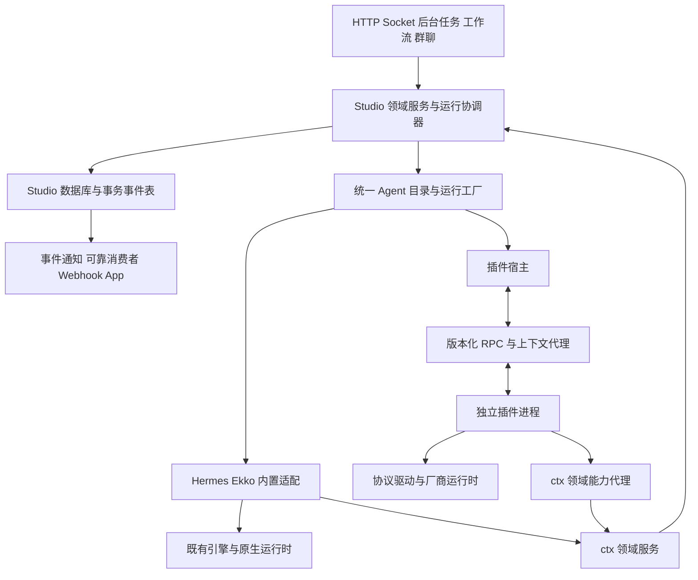

# Studio 插件体系与统一上下文架构规划

日期：2026-10-23

状态：设计草案 v0.3，已进入实施。本文定义完整交付目标；具体已实现接口与剩余工作见[实施记录](studio-plugin-progress.md)，不能把本篇所有目标当成当前能力。

源码基线：`8f215f59d`。本文面向后端、Agent 集成、客户端和发布工程的实施者。

阅读顺序：本篇说明目标、职责和关键决策；[接口契约](studio-plugin-contracts.md)定义 `ctx`、Agent、事件与生命周期；[迁移与验收计划](studio-plugin-execution.md)定义任务、依赖、兼容和发布门槛。

## 1 目标与完整交付范围

Studio 将现有后端能力组织为有类型、有作用域的 `ctx`。内置功能、第三方插件和自定义 Agent 使用同一套业务契约。用户能够提供自己的 Agent 实现，并通过目录发现、单聊、群聊、工作流、全局 Agent 和 API 使用它支持的能力。

“一次性构建到位”指这一轮架构项目最终交付完整目标。实施可以按依赖拆分提交，但临时适配器、旧运行链和新运行链长期并存不算完成。规划已确认并开始代码迁移，完成状态必须以验收证据为准。

完整交付包含：

1. 后端能力目录、公共 DTO、统一错误、调用身份与资源作用域。
2. `ctx.agents.register()`、服务扩展、事件订阅、执行钩子和资源清理入口。
3. Agent 类型、配置实例、原生会话和 Run 的明确分离，以及统一执行协调器。
4. 插件发现、安装、版本检查、启停、升级、配置、数据迁移和诊断；用户安装的插件可卸载，系统插件不可卸载。
5. 全部 14 个 Coding Agent 的独立适配插件作为系统插件随 Studio 默认安装、不可删除；Hermes、Ekko 保留内置模块，通过相同 Agent 执行契约接入，无需插件化。
6. Web、Desktop、App 使用动态 Agent 目录；现有管理能力和历史数据保持可用。
7. 独立插件开发样例、SDK 契约测试、打包和三平台验收。

本轮后端架构不包含公开插件商城、任意第三方前端代码注入、任意语言的原生 SDK，以及对不可信本地代码的操作系统沙箱。第三方 Agent 的基础界面通过元数据、配置 schema、能力描述和标准事件呈现。未来增加这些能力时必须继续沿用本文的身份、版本和资源归属。

## 2 当前实现与改造依据

以下是实际实现，不以架构文档中的目标目录代替源码现状。

| 当前位置 | 实际职责 | 目标变化 |
| --- | --- | --- |
| [bootstrap/routes.ts](../../packages/server/src/bootstrap/routes.ts) | 静态装配各模块 HTTP 路由 | 保留传输入口，业务调用统一领域服务；插件路由使用受控网关 |
| [public/sessions.ts](../../packages/server/src/modules/studio/public/sessions.ts) | 导出会话等 repository 操作 | 对外提供完整会话用例，存储接口留在内部 |
| [controllers/sessions.ts](../../packages/server/src/modules/studio/controllers/sessions.ts) | 包含访问检查、运行时清理、删除和通知 | 将完整用例下沉，HTTP 只做输入输出映射 |
| [controllers/chat-run.ts](../../packages/server/src/modules/studio/controllers/chat-run.ts) | `runOnce` 经应用服务直接调用旧运行宿主，与 Socket 共用准入和引擎；已移除本地回连 | HTTP 与 Socket 直接调用同一个运行协调器 |
| [coding-agents/services/index.ts](../../packages/server/src/modules/coding-agents/services/index.ts) | 约 3900 行，配置准备、环境、安装、MCP 和启动 | 按平台能力、协议驱动、厂商适配拆分 |
| [runtime/run-manager.ts](../../packages/server/src/modules/coding-agents/services/runtime/run-manager.ts) | 约 3900 行，进程、厂商协议、消息落库、用量、通知 | 协议转换进入插件；状态、持久化和广播归协调器 |
| [registry/native-agents.ts](../../packages/server/src/modules/coding-agents/services/registry/native-agents.ts) | 部分 Agent 已有定义、配置准备、启动适配表 | 提取可复用 ACP 驱动，消除固定厂商分发表 |
| [contracts/agents/runtime.ts](../../packages/server/src/modules/studio/contracts/agents/runtime.ts) | 固定运行时枚举及 family 映射 | 使用运行时校验的开放 ID 与注册目录 |
| [webhooks/business-events.ts](../../packages/server/src/modules/studio/services/webhooks/business-events.ts) | 进程内消费者分发，含内部 payload | 建立类型化公开投影；可靠投递单独持久化 |
| [config/agents.json](../../config/agents.json) 与 [客户端目录](../../packages/client/src/utils/agent-catalog.ts) | 静态 Agent 元数据和别名 | 改为后端有效目录；静态内容仅作为内置类型/随包插件元数据种子和旧协议投影 |
| [bootstrap/coding-agent-adapters.ts](../../packages/server/src/bootstrap/coding-agent-adapters.ts) | 将运行状态和服务函数注入共享门面 | 作为迁移切入点，最终由统一协调器和平台服务替代 |

仓库已有分层和注入基础，但部分门面仍直接暴露存储、Socket 或宽泛的 `any`。新增一个包含这些对象的大型全局变量不能达到目标。新的公共边界必须明确数据、行为、调用权限和副作用的负责方。

## 3 关键架构决策

下表为本规划采用的设计基线，不代表已经实现或经过运行验证。

| ID | 决策 | 影响 |
| --- | --- | --- |
| D01 | 采用有类型的领域服务组成 `ctx`，公共调用不暴露 Koa、Socket、SQLite 和具体 Agent 对象 | 接口可供 HTTP、后台任务和插件复用 |
| D02 | 分开 PluginContext、ExecutionContext、AgentRuntimeContext | 插件生命周期与单次调用权限不混合 |
| D03 | 所有 Agent 共享类型定义、会话和执行契约；Hermes/Ekko 由 bootstrap 注册，插件通过 ctx 注册 | 共用运行协调器，保留不同装载与管理生命周期 |
| D04 | 核心协调器唯一负责 Run 状态、消息持久化、用量归并和系统事件 | 避免双写和重复完成 |
| D05 | 插件后端在独立 Node worker 进程执行，SDK 使用 RPC 代理访问平台 | 隔离故障并支持独立升级；不宣称是 OS 权限沙箱 |
| D06 | 标准 ACP、进程和流式解析工具形成独立驱动库 | 复用协议代码，厂商特殊行为留在各插件 |
| D07 | 事件通知、可靠消费、可阻断钩子分别定义 | 明确顺序、等待、失败和重试语义 |
| D08 | 插件安装和注册采用 staging 后原子发布；Run 固定提供方快照，分别记录内置实现版本或插件 generation | 半激活插件不会进入可执行目录，内置 Agent 无需伪造插件身份 |
| D09 | 历史 ID 和数据保持可读，升级采用可重入的增量迁移 | 卸载插件也不删除会话、工作流证据和用量 |
| D10 | 先在隔离环境完成迁移，再统一切换；移除重复业务执行路径，保留 Hermes/Ekko 内置模块及其运行适配 | 多个实施阶段服务于同一个完整交付目标 |
| D11 | 现有 14 个 Coding Agent 是默认安装且不可卸载的系统插件；身份和删除策略由宿主随包清单确定 | UI 与所有管理入口统一执行保护，第三方插件仍可安装和卸载 |

## 4 架构与代码归属



拟议目录：

```text
packages/studio-plugin-sdk/               公共类型、schema、SDK 代理、插件开发入口
packages/studio-plugin-runner/            worker 引导、RPC、资源清理、握手
packages/studio-agent-drivers/            标准 ACP、JSONL 等无厂商业务的可选库
plugins/agent-claude-code/                独立 manifest、配置、适配、管理和测试
plugins/agent-codex/
plugins/agent-.../                       其余 Coding Agent 及第三方扩展
packages/ekko-agent/                     保留 Ekko 引擎规范源码
packages/server/src/modules/hermes/      保留内置模块、bridge、原生管理与契约适配
packages/server/src/modules/ekko/        保留内置模块、引擎集成、原生管理与契约适配
packages/server/src/modules/studio/
  contracts/context/                    平台服务契约与 SDK 类型的映射
  services/context/                     可信入口创建执行上下文
  services/plugins/                     插件安装目录、worker、版本、依赖、作用域
  services/agents/                      统一 Agent 目录、实例、能力、原生会话绑定
  services/runs/                        统一协调器、状态机、结果归并
  services/events/                      通知、事务事件表、可靠消费、钩子
  services/<domain>/                    会话、群聊、工作流、文件等领域实现
  repositories/                         插件、Agent 实例、运行和事件持久化
packages/server/src/bootstrap/           组合平台实现、内置 Agent 工厂及随包插件清单
```

Hermes、Ekko 保留在现有内置模块中。bootstrap 将它们的运行工厂注入统一 Agent 目录；运行协调器使用相同契约调用。Ekko 继续使用 `packages/ekko-agent` 的库 API，Hermes 保留 bridge、profile、原生管理和独立 Python 运行时；本项目不重写上游 Hermes。

二者不需要 Studio 插件 manifest、插件 worker、插件 generation 或插件安装记录，继续遵循内置模块与引擎自身的生命周期。插件工件不得导入 Studio server 私有实现；内置模块遵守现有 server 模块边界。

当前 [模块边界契约](../harness/server-module-boundaries.md) 和 [机械检查](../../scripts/server-module-boundaries.mjs) 尚未涵盖这些新包。实施任务必须同步修改边界契约及检查器。服务器仍只通过 `bootstrap` 做具体组合；SDK 和驱动库不能反向导入 server、client 或具体插件。

## 5 统一上下文的能力目录

`ctx` 是类型化服务入口和资源作用域。领域服务保留独立实现，内部按需注入窄接口。禁止每个领域服务都依赖完整 `StudioContext`，以免形成循环依赖和隐式服务查找。

当前实施已将会话删除和新 Agent 实例启动分别收敛为 HTTP/SDK 共用服务。`ctx.runs.start` 暂限未绑定 session/workspace/Run 的独立实例执行，接收后由协调器持有生命周期；旧聊天准入规则已迁入服务，HTTP/Socket 通过调用者和事件端口共用原执行器，HTTP 已移除本机回环；统一上下文接入和父子 Run 迁移仍未完成。实际边界见[实施记录](studio-plugin-progress.md#t02-进展agent-实例启动共用领域服务)，下表继续定义完整目标。

以下目录覆盖目前后端的主要业务。每个拟议公共方法在实现前必须完成输入输出 schema、权限、取消、错误和副作用归属登记。

| 命名空间 | 领域能力 | 边界 |
| --- | --- | --- |
| `agents` | 类型贡献、实例、目录、状态、配置和管理操作 | 插件经 ctx 注册，内置 Agent 经 bootstrap 注册；执行上下文只操作获准实例 |
| `runs` | 发起、读取、订阅、取消、交互响应 | 协调器拥有状态；插件不能任意设置终态 |
| `sessions` | 会话、消息、分类、归档、分享、删除 | 包含授权、关联清理和通知的完整用例 |
| `tasks`、`plans` | 会话目标与步骤计划 | 保留当前 revision、运行绑定和适用入口限制 |
| `groups` | 群组、参与者、消息、Agent 调度 | 按房间访问规则授权；成员身份与 Agent 实例分开 |
| `workflows` | 定义、校验、执行、证据、计划触发 | 节点指向 Agent 实例和快照，不枚举厂商 |
| `globalAgents` | 持续任务、后台执行和回传 | 通过协调器执行，显式生命周期和预算 |
| `profiles`、`workspaces` | 平台作用域与工作区管理 | Hermes Home 由内置 Hermes 模块管理，Coding Agent CLI Home 由对应插件管理 |
| `models` | 目录、模型选择、授权调用、流和计量 | 普通插件优先使用授权代理，不获取所有提供商原始密钥 |
| `files` | 浏览、上传、下载、预览、Git 差异 | 延用路径策略及远程后端能力，使用文件引用 |
| `interactions` | 审批、澄清、人工输入和结果响应 | 使用持久化 interaction ID；权限不依赖调用者传来的 user ID |
| `voice`、`media` | STT、TTS、媒体操作和产物 | 模型资产和设备访问属于各服务的管理权限 |
| `browser`、`devices` | Studio 浏览器、桌面能力、MCU 和 App 设备请求 | 由现有桥接和授权流程控制，保留用户确认 |
| `connections`、`notifications` | App 连接、推送、Webhook 和外部消息投递 | 凭据和投递目标不随事件 payload 暴露 |
| `usage`、`logs`、`diagnostics` | 已授权范围内的用量、日志和诊断查询 | 插件日志关联身份；不能写入任意用户账单 |
| `settings`、`presentation` | 平台偏好、主题、宠物等平台管理 | 明确用户、profile 或应用级范围；不把桌面对象传给插件 |
| `http`、`scheduler` | 插件路由和计划任务贡献 | 仅在插件作用域注册，宿主控制认证和任务执行身份 |
| `storage`、`secrets`、`processes`、`net` | 插件数据、秘密引用、受管进程和请求 | 有插件归属、权限和资源清理；不导出核心数据库连接 |
| `services` | 插件间声明式服务契约 | 命名空间、schema、版本、依赖图；禁止覆盖核心服务 |
| `on`、`once`、`emit`、`events`、`hooks` | 通知、可靠消费、扩展事件、受控钩子 | 语义见接口契约 |
| `lifecycle`、`logger` | 就绪、清理、健康和结构化日志 | worker 崩溃时由宿主兜底回收 |

Hermes Kanban、Cron、Journey、原生插件和 memory，以及 Ekko Skills/MCP/记忆，继续归各自内置模块所有；Coding Agent 专属设置归对应插件所有。通过 `agents.management` 的能力和 schema 暴露；未来确有通用业务语义时再提取共享服务。Agent 原生运行时的安装或更新能力与 Studio 插件的安装、升级、卸载是两套操作。

平台自身的用户管理、升级和基础认证仍是核心能力。可以经授权的管理服务使用，不能通过普通插件获得原始 token、任意数据库或认证中间件替换权。

## 6 Agent 和运行的职责

| 对象 | 寿命与内容 | 持有者 |
| --- | --- | --- |
| Agent 类型 | 稳定 type ID、展示信息、配置 schema、能力、工厂 | 内置模块或插件提供，统一目录管理 |
| Agent 实例 | 类型、用户配置、profile、工作区策略、配置 revision | Studio 持久化 |
| 原生会话 | CLI thread、RPC session、Python bridge 或远程 session | 内置模块或插件适配；Studio 保存不透明恢复引用 |
| Run | 一次输入、状态、消息、用量、交互、来源、预算和提供方版本快照 | 核心协调器 |

一个原生会话可处理多轮 Run。插件激活不等于一次 Run；Run 完成也不等于必须销毁原生进程。审批和澄清属于 Run 内的可恢复交互。

协调器负责：验证身份和能力、分配 ID、冻结配置与版本、租用运行时、处理事件、落库、归并用量、推进终态、发布通知、向各传输出口投影。运行时负责：准备厂商配置、建立或恢复原生会话、执行、转换原生事件、取消和清理资源。

运行时不直接写 Studio 的消息表、用量表，也不拿 Socket server 发消息。现有 `run-manager` 中这些行为必须迁入协调器，Hermes/Ekko 中对应的持久化和广播也交由同一协调器。共享驱动库只处理协议和进程协作；Coding Agent 的厂商 ID、命令和特殊用量语义留在插件，Hermes/Ekko 的原生适配留在内置模块。

所有 Agent 的能力声明由核心验证结构，结合已安装运行时版本、操作系统、配置和动态探测形成有效能力。`unknown` 与 `unsupported` 分开；未知能力在执行前需要探测，不能当作支持。工作流和群聊对无人值守交互的处理由平台策略决定，不能静默批准。

## 7 插件宿主与部署模型

插件工件包含 manifest、编译后的后端入口、配置 schema、资源及锁定依赖。支持本地开发目录、版本固定的压缩包和 npm 来源。生产工件需要能离线装载；源码安装和构建属于独立准备阶段。

一个运行 worker 绑定 `(pluginId, generation, platformProfileId)`。同一 profile 内按 Agent 实例及原生会话键分配执行环境，不能因模型相同就共享用户会话。目录可从 manifest 提前展示静态元数据，实际可执行状态以该 profile 的注册、探测和权限结果为准。

插件默认采用独立 Node worker；随 Studio 分发的 Coding Agent 插件也经过相同 runner 和 RPC。高频文本事件批量传输，大文件使用引用。宿主提供取消、流量控制、超时、异常退出处理和清理受管子进程树。

Hermes/Ekko 按内置模块启动，保持各自引擎和进程模型，不经过插件 runner。统一目录、ctx 领域服务、运行协调器和核心事件分发独立于插件宿主存活；插件宿主停用或不可用时，Hermes/Ekko 的目录、执行和原生管理仍须可用。

插件可以运行受信任的本地代码。独立进程提供故障隔离，不阻止代码使用其操作系统用户已有的文件或网络权限。平台 capability 控制的是 Studio API 访问。第一版安装模型必须明确体现代码信任，不能将 manifest 权限表描述成完整沙箱。

Studio 启动时从随包清单和 `config.appHome` 下的安装记录读取插件。工件、可写配置和数据分目录保存，禁止写入 `dist` 或改动用户原生 Home 来管理插件自身状态。各平台签名、Node/Electron 启动、原生依赖和资源路径都需要独立验证。

### 7.1 系统插件与用户插件

现有 14 个 Coding Agent 都属于系统插件。Desktop、npm、Docker 发布工件必须包含锁定版本的插件包；新安装和现有数据升级时自动建立安装记录，无需用户逐个添加或首次启动联网下载插件。目录始终保留它们的类型和状态，未配置、原生 CLI 缺失或暂时不可运行不等于插件未安装。

系统插件不可从 Studio 删除或卸载。宿主从受信任的随包清单确定保护策略；插件 manifest、请求参数或用户配置不能自行解除保护。UI 不提供卸载操作，HTTP、MCP、SDK 及内部管理服务共用后端检查，批量操作、force 或同 ID 覆盖安装也不能绕过。

安装、启用、原生 CLI 就绪分别记录。保留按 profile 停用与故障隔离机制；停用不删除插件包、安装记录或目录定义，也不因重启而抹去用户的停用选择。默认安装不要求所有 worker 常驻。系统插件的版本升级仍使用 generation、排空和回滚机制，旧代工件的受控回收不等于卸载系统插件。

这里默认安装的是 Studio 适配插件。Cursor、Antigravity、ZCode 等原生 CLI 的手工安装约束，以及所有 Agent 的登录、凭据和原生配置规则保持现状；插件页显示“系统插件已安装”，运行就绪状态另行展示。第三方插件遵循正常的用户安装、停用和卸载流程。

## 8 事件和钩子

事件入口必须是 `ctx` 的一等 API。普通 `on/once` 面向当前激活期通知；重要外部副作用采用带游标和幂等键的可靠消费者。提交后的业务事件不能由监听器返回值反向修改已发生的结果。

核心业务变化和待发送事件在同一数据库事务中保存。事务提交后再分发；现有 Webhook、App 推送和插件监听都消费同一事件来源，经各自投影过滤。插件不接收当前 `BusinessEvent.payload` 的内部原始对象或推送目标秘密。

允许改变行为的节点使用显式 hook，例如 `ctx.hooks.before('runs.start', handler)` 和 `ctx.hooks.before('sessions.remove', handler)`。hook 的输入、可返回补丁、顺序、超时和失败策略固定。hook 不得修改 actor、权限、原生秘密、run ID 或提供方版本选择。变更输入后宿主重新校验授权、schema 和能力。

## 9 数据与兼容

新增持久化对象包括插件安装版本、profile 启用状态、权限授予、配置 revision、Agent 实例、原生会话引用、运行版本快照、事务事件和可靠消费游标。插件独立数据保存在命名空间内，核心数据只能经领域服务修改。

已有 Agent ID、会话 ID 和原生恢复 ID 保留。不同位置的 `ekko`、`ekko-agent`、`claude`、`claude-code` 等既有标识通过显式映射处理，不能批量按字符串替换。新 ID 使用 publisher 命名空间，校验同时检查格式、目录存在、状态和访问权。

对现有会话做可重入回填，建立 Agent 实例和配置引用；旧字段作为兼容读取/输出字段保留至协议退役。历史导出、工作流快照、群成员和用量归属一并纳入迁移。缺失插件时保留可阅读历史，并明确标注无法继续执行，不能换用别的 Agent。

保留已发布的 HTTP、Socket 和 App/MCU 协议，兼容层只转换协议，不保留第二套业务执行器。新版客户端从有效目录获取能力；旧客户端只接收其能表示的投影，未知类型明确显示不可操作或引导升级。旧版本二进制读取新数据库前必须经过兼容验证，不能以切换工件代替数据库回滚。

## 10 完成标准

满足以下条件才允许宣布完整架构交付：

- 14 个 Coding Agent 的独立插件工件随 Studio 默认安装，所有管理入口拒绝卸载；Hermes/Ekko 保持内置模块，通过相同执行契约运行，插件宿主停用不影响其可用性。
- 一个独立测试仓库中的自定义 Agent，依赖发布 SDK 即可接入其声明支持的全部 Studio 入口；不修改 server/client 厂商枚举。
- 执行协调、持久化、用量和系统事件只有一条权威路径；旧 `run-manager` 中已迁出的职责被删除。
- Agent 管理、配置、恢复、审批、澄清、取消、压缩、图片、MCP 和用量按原有支持范围通过逐项回归。
- 系统插件自动安装与卸载保护、用户插件安装到卸载、失败恢复、升级排空、历史可读和数据回滚有可重复证据。
- 公共契约无 Koa/Socket/SQLite 类型和无约束 `any`；机械边界检查阻止插件导入 server 私有实现。
- Web、Desktop、App 的新目录和配置体验验收完成；Desktop/npm/Docker 工件可在干净环境装载插件。

具体任务、删除清单、迁移顺序和验收编号以[实施计划](studio-plugin-execution.md)为准。
